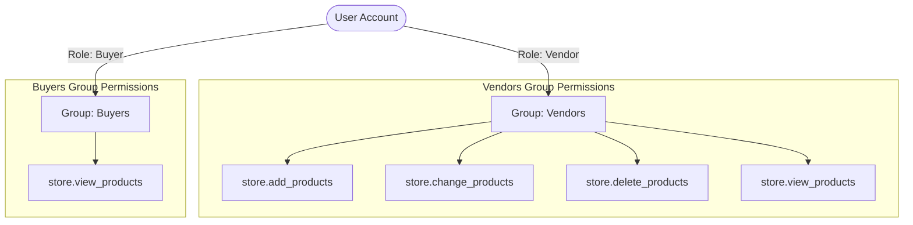

# Security and Access Control Plan
## eCommerce Web Application (Part 1)

### 1. Security Overview
Security and authorization form the backbone of this multi-vendor eCommerce application. Because vendors manage inventory and buyers execute financial orders, clear isolation boundaries must exist to protect sensitive merchant data and customer credentials.

This document outlines the authentication workflows, role-based access control (RBAC), custom permissions architecture, password hashing standards, and token security policies implemented across the application.

---

### 2. Password Hashing & Credential Storage
To ensure credentials remain uncompromised even in the catastrophic event of a database breach:
- **Zero Plaintext Storage**: Passwords are never written to disk or logged in plain text.
- **Django Password Hasher**: The system uses Django's default cryptographic hasher: **PBKDF2 with a SHA-256 hash**, configured with 600,000+ iterations and a random cryptographic salt.
- **Verification**: User authentication via `django.contrib.auth.authenticate()` computes the salted hash of incoming credentials in constant time to prevent timing attacks.
- **Password Updates**: Changing credentials must always invoke `user.set_password(raw_password)`, which computes a fresh salt and re-hashes the string before database persistence (`user.save()`).

---

### 3. Role-Based Access Control (RBAC) & Group Architecture

The platform categorizes users into two primary functional groups upon registration using Django's `django.contrib.auth.models.Group`:



#### Group Definitions:
1. **`Vendors`**:
   - Represents merchants who list and maintain goods for sale.
   - Assigned permissions: `store.add_products`, `store.change_products`, `store.delete_products`, `store.view_products`.
   - Authorized views: Store creation, store dashboard, add product, edit product, delete product.
2. **`Buyers`**:
   - Represents customers who browse, review, and purchase items.
   - Assigned permissions: `store.view_products`.
   - Authorized views: Product catalogue, product detail, submit review, session cart, checkout.

---

### 4. Custom Model Permissions
Permissions are declared in `store/models.py` within the `Product` model's `Meta` options:

```python
class Meta:
    permissions = [
        ("add_products", "Can add products"),
        ("change_products", "Can change products"),
        ("delete_products", "Can delete products"),
        ("view_products", "Can view products"),
    ]
```

#### Enforcement Strategy:
- **View-Level Guards**:
  - `@login_required`: Applied to all views requiring an authenticated session (dashboard, product CRUD, reviews, checkout). Unauthenticated requests redirect to `reverse('store:login')`.
  - **Explicit Permission Checks**: In views such as `add_product` or `edit_product`, the view explicitly checks:
    ```python
    if not (request.user.has_perm('store.change_products') or request.user.groups.filter(name='Vendors').exists()):
        return render(request, 'store/error.html', {'error': 'You do not have permission to modify products.'}, status=403)
    ```
- **Object-Level Ownership Validation**:
  - In addition to holding the general permission, a vendor can **only** edit or delete products belonging to their own store:
    ```python
    if product.store.owner != request.user:
        return render(request, 'store/error.html', {'error': 'Unauthorized: You do not own this product.'}, status=403)
    ```

---

### 5. Password Reset Workflow & Token Security

When a user forgets their password, the platform implements a tokenized recovery flow matching the lesson PDF specifications:

```mermaid
sequenceDiagram
    autonumber
    actor User as Buyer / Vendor
    participant Web as Django Web App
    participant DB as SQLite DB
    participant Mail as Console Email

    User->>Web: Submits email on Password Reset Request Form
    Web->>DB: Query User by email
    alt User Found
        Web->>Web: Generate token = secrets.token_urlsafe(16)
        Web->>Web: Calculate SHA-1 hash of token
        Web->>DB: Save ResetToken(user, hashed_token, expiry=now+5min)
        Web->>Mail: Send EmailMessage with reset link (printed to console)
        Web->>User: Confirmation message ("Reset email sent")
    else User Not Found
        Web->>User: Friendly notification / failure handling
    end

    User->>Web: Clicks Reset Link (URL contains raw token)
    Web->>DB: Look up ResetToken matching SHA-1(token) & used=False
    alt Token Valid & Unexpired
        Web->>Web: Store username & token in request.session
        Web->>User: Render Set New Password Form
        User->>Web: Submits new password & confirmation
        Web->>Web: Validate match; user.set_password()
        Web->>DB: user.save(); user_token.delete() (one-time use)
        Web->>User: Redirect to Login with success alert
    else Token Expired or Invalid
        Web->>DB: If expired, delete token
        Web->>User: Display "Reset link expired or invalid"
    end
```

#### Security Safeguards:
- **Token Randomness**: Built using Python's cryptographically secure `secrets.token_urlsafe(16)` generator.
- **Database Obfuscation**: Tokens are stored as SHA-1 hex digests in the `ResetToken` table, so an eavesdropper reading database dumps cannot directly craft valid URL query strings.
- **Strict Time-To-Live (TTL)**: Tokens expire after 5 minutes.
- **One-Time Invalidation**: Once consumed, the token record is either deleted or marked `used = True` to prevent replay attacks.

